


<a href="https://www.linkedin.com/in/gregorius-felix-caton-erawan-751789239/"></a><a href="assets/Gregorius%20Felix%20Caton%20Erawan_Resume.pdf"></a><a href="https://github.com/GregoriusFelix?tab=repositories"></a>


<a href="https://github.com/GregoriusFelix/xmum-navigate"></a>

<a href="https://github.com/GregoriusFelix/Project_Tracker"></a>

<a href="https://github.com/GregoriusFelix/Mobile-App_XMUM-Navigate"></a>

<a href="https://github.com/GregoriusFelix/SVV_Project"></a>

<a href="https://github.com/GregoriusFelix/Pac-Man-AI-Search"></a>

<a href="https://github.com/GregoriusFelix/The_Grind"></a>


<!-- Regenerate with `python scripts/generate_cards.py`; set STATIC=1 for still frames. -->
