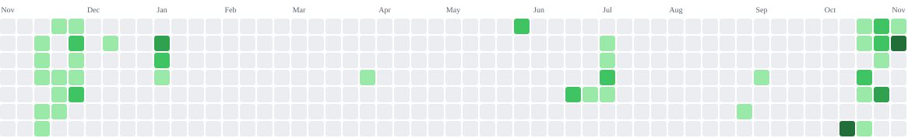

<picture>
  <source media="(prefers-color-scheme: dark)" srcset="assets/intro-dark.svg" />
  <source media="(prefers-color-scheme: light)" srcset="assets/intro.svg" />
  
</picture>

Xiamen University Malaysia · B.Eng. Software Engineering (Honours) · Class of 2027

---

I study Software Engineering at Xiamen University Malaysia and build web and mobile applications. My work spans React interfaces, ASP.NET Core and Node.js backends, and database-driven applications in Java.

> **Available for a full-time Software Engineering / Software Developer internship from February 2027 onward.**

## About me

- Pursuing a Bachelor of Engineering in Software Engineering (Honours), with expected graduation in September 2027.
- CGPA: **3.67 / 4.00**; recipient of the Xiamen University Malaysia Merit Scholarship with a 75% tuition waiver.
- Currently developing **XMUM Navigate**, my final-year project: a web-based campus companion for navigation, venue recommendations, and canteen information.
- Alongside development, I have led student arrival helpers and served as Vice President of the International Student Ambassador committee.

## Tech stack

**Languages**

**Frontend & backend**

**Databases & services**

**Mobile, games & tools**

## Projects

### [XMUM Navigate · Final-Year Project](https://github.com/GregoriusFelix/xmum-navigate)

A web-based campus companion for Xiamen University Malaysia, focused on campus navigation, venue recommendations, and a canteen directory. Currently in development.

`React` `Vite` `Node.js` `Express` `PostgreSQL`

### [Project Tracker](https://github.com/GregoriusFelix/Project_Tracker)

A full-stack application for managing projects, tasks, and users, with a React interface and an ASP.NET Core API backed by Entity Framework Core and SQL Server.

`React` `C#` `ASP.NET Core` `Entity Framework Core` `SQL Server`

### [XMUM Navigate · Mobile App](https://github.com/GregoriusFelix/Mobile-App_XMUM-Navigate)

A Flutter campus companion with registration, sign-in, profile, and campus content screens. Uses Firebase Authentication and Cloud Firestore.

`Flutter` `Dart` `Firebase`

### [SVV Project · Registration & Authentication](https://github.com/GregoriusFelix/SVV_Project)

A travel website authentication project with registration, email verification, input validation, and bcrypt password hashing. Built with a Node.js and Express backend and MySQL storage.

`JavaScript` `Node.js` `Express` `MySQL` `HTML` `CSS`

### [Pac-Man AI Search](https://github.com/GregoriusFelix/Pac-Man-AI-Search)

A Godot Pac-Man project exploring AI search and ghost pathfinding through game movement and chase behavior.

`Godot` `GDScript` `AI Search`

### [The Grind](https://github.com/GregoriusFelix/The_Grind)

A multi-page café and restaurant website with menu, ordering, gallery, loyalty, and careers pages.

`HTML` `CSS`

## Contributions, Tetris style

<picture>
  <source media="(prefers-color-scheme: dark)" srcset="https://raw.githubusercontent.com/GregoriusFelix/GregoriusFelix/output/tetris-contribution-graph-dark.svg" />
  <source media="(prefers-color-scheme: light)" srcset="https://raw.githubusercontent.com/GregoriusFelix/GregoriusFelix/output/tetris-contribution-graph.svg" />
  
</picture>

[Animation by abozanona](https://github.com/abozanona/pacman-contribution-graph)

## More from my résumé

- **Peatland Fire Alert System, IBM Z Datathon 2026:** Built the frontend dashboard and an interactive GeoJSON map with risk markers, zooming, dragging, and selection using vanilla JavaScript, HTML, CSS, and SVG.
- **Nomly, AI-Powered Recipe Recommendation App:** Defined the shared UI theme and CSS, built the profile insights dashboard and pantry interface, and added frontend input validation.
- **Halabo, Indonesian Travel Booking Website:** Built the booking flow with Java Servlets and MySQL, including destination and package selection, customer information autofill, and responsive page layouts.

## Internship opportunities

I'm looking for a full-time internship from **February 2027 onward**, with an interest in software engineering, full-stack development, and web application development.

[Contact me on LinkedIn](https://www.linkedin.com/in/gregorius-felix-caton-erawan-751789239/) or [view my résumé](assets/Gregorius%20Felix%20Caton%20Erawan_Resume.pdf).
